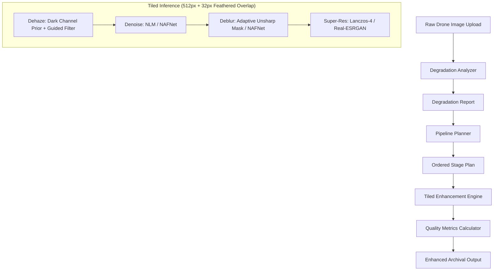

# InfraClarity AI: System Architecture

InfraClarity AI restores degraded optical imagery from drone and telephoto inspection flights across energy and utility infrastructure (substations, transmission towers, pipelines).

## High-Level Processing Flow

## Core Modules

### 1. Degradation Analyzer (`backend/app/analysis/`)
Analyzes five core optical characteristics:
- **Blur Variance**: $\mathrm{Var}(\nabla^2 I) = \frac{1}{N} \sum (L(x,y) - \mu_L)^2$ on grayscale luminance.
- **Atmospheric Haze**: Mean of $15 \times 15$ Dark Channel Prior $J^{\mathrm{dark}}(x) = \min_{y \in \Omega(x)} (\min_{c} I_c(y))$.
- **Sensor Noise**: Wavelet-based median absolute deviation (MAD) $\sigma = \mathrm{Median}(|d|) / 0.6745$.
- **RMS Contrast**: Standard deviation of normalized luminance.
- **Resolution Verification**: Flags imagery where the shorter dimension is below 1080px.

### 2. Pipeline Planner (`backend/app/planner/`)
Enforces strict restoration invariants regardless of user preset or manual toggle:
1. **Dehaze First**: Restores transmission and airlight before filtering.
2. **Denoise Second**: Suppresses sensor grain prior to edge accentuation or upscaling.
3. **Deblur Third**: Re-sharpens defect edges on clean, dehazed arrays.
4. **Super-Resolution Last**: Scales up the cleaned, reconstructed image signal.

### 3. Tiled Inference Engine (`backend/app/enhance/tiling.py`)
- Slices arbitrary resolution images into 512px blocks with 32px overlap.
- Uses 2D cosine-feathered blending:
  $$I_{\mathrm{out}} = \frac{\sum w_i \cdot T_i}{\sum w_i}$$
- Guarantees exact identity reconstruction within $1/255$ intensity.
- Auto-halves tile dimensions on memory constraints to prevent out-of-memory errors on 24MP+ images.

### 4. Background Job Manager & SSE Streaming (`backend/app/jobs/`)
- Non-blocking execution via `ThreadPoolExecutor`.
- Live tile-by-tile progress streamed to the frontend via Server-Sent Events (`/api/v1/jobs/{id}/events`).
- Automatic scheduled reaper purges storage cache older than 1 hour.
